# OH6KW Jäsenrekisteri – WordPress-lisäosa yhdistyksille

Jäsenrekisteri ja jäsenmaksulaskutus WordPressin hallintapaneeliin suomalaisille yhdistyksille. **Täysin ilmainen** – ei maksullista versiota, kuukausimaksuja eikä rajoituksia jäsenmäärään.

Lähetä koko jäsenistölle jäsenmaksulaskut sähköpostilla yhdellä painalluksella, ja tulosta paperilaskut niille, jotka niitä haluavat. Jokainen lasku saa oman suomalaisen viitenumeron, QR-koodin ja pankkiviivakoodin. Tuo maksut pankin tiedostosta, ja ne kohdistuvat oikeille jäsenille viitteen perusteella, vaikka maksaja olisi puoliso tai vanhempi. Vuosikokoukseen saat vuosiraportin ja äänioikeusluettelon, kirjanpitäjälle valmiin vientiehdotuksen jäsenmaksuista ja kirjepostia varten osoitetarrat suoraan tavalliselle tarra-arkille.

[](https://github.com/oh6kw/oh6kw-jasenrekisteri/releases/latest)


[](LICENSE)
[](https://ko-fi.com/oh6kw)

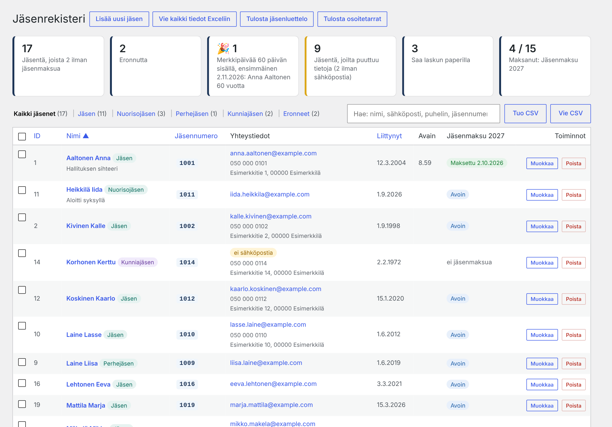

> Kuvissa on keksitty esimerkkiyhdistys. Nimet, jäsennumerot, osoitteet ja puhelinnumerot ovat kuvitteellisia, ja tilinumero on pankkien yleisesti käyttämä esimerkkinumero.

## Toimii vain hallintapaneelissa

Lisäosa ei julkaise sivustolle mitään. Se ei lisää sivuja, lomakkeita, lyhytkoodeja eikä lohkoja, eikä jäsentietoja näy sivuston kävijöille. Jäsenrekisteri on WordPressin hallintapaneelissa vain ylläpitäjien käytössä.

WordPress toimii rekisterin ”moottorina”, ja sen valmiit ominaisuudet hoitavat paljon:
- **Kirjautuminen ja käyttäjät:** rekisterin näkevät vain ylläpitäjät. Kirjautumista voi vahvistaa esimerkiksi kaksivaiheisella tunnistautumisella erillisellä lisäosalla.
- **Automaattiset päivitykset:** kun lisäosa on asennettu WordPress.orgista, WordPress voi päivittää sen automaattisesti.
- **Varmuuskopiot:** rekisteri on sivuston omassa tietokannassa, joten webhotellin tai varmuuskopiolisäosan kopiot kattavat myös sen. Lisäosassa on lisäksi oma varmuuskopio rekisterin siirtoon.
- **Sähköposti:** laskut lähtevät WordPressin sähköpostin kautta. SMTP-lisäosalla ne lähtevät yhdistyksen omalta sähköpostitililtä.
- **Salattu yhteys (HTTPS)** ja palvelimen ylläpito tulevat sivuston omasta webhotellista.

Näin yhdistys saa jäsenrekisterin ilman erillistä palvelua, kuukausimaksuja tai uusia tunnuksia. Rekisteri toimii jo olemassa olevan sivuston taustalla.

## Ominaisuudet

**Jäsenet**
- Omat jäsenluokat ja jäsenmaksut, esim. Jäsen 25 €, Nuorisojäsen 10 €, Perhejäsen 10 € ja Kunniajäsen 0 €. Luokat näkyvät jäsenlistassa välilehtinä.
- 0 €:n luokan jäsenille ei tehdä laskua, mutta he saavat tiedotteet.
- Haku, lajittelu, joukkotoiminnot (aseta luokka, merkitse eronneeksi, lasku paperilla) sekä jokaisen jäsenen lasku- ja maksuhistoria.
- Vapaasti nimettävä lisätunniste, esim. *Jäsennumero*.
- **Omat lisäkentät**, esim. *Avain* (kerhotalon avaimen numero) tai *Talkoolistalla*. Kenttä voi olla teksti tai valintaruutu, ja sen voi näyttää jäsenlistassa omana sarakkeenaan. Haku kentän nimellä (esim. ”avain”) löytää kaikki, joilla kenttä on täytetty.
- Eroamispäivä tallentuu, kun jäsen merkitään eronneeksi.
- **Merkkipäivät:** tasavuosia täyttävät (jäsenen vapaaehtoinen *syntymävuosi tai -päivä*; pelkkä vuosi riittää) ja jäsenyysvuodet (liittymispäivästä) asetuksissa valituilla vuosilla, esim. 50, 60, 70, 80 ja 90 vuotta tai 10, 25 ja 50 vuotta jäsenenä. Lähestyvät merkkipäivät näkyvät jäsenlistassa. Ominaisuuden voi kytkeä pois asetuksista.
- Tuonti ja vienti CSV-muodossa (Excel-yhteensopiva). Sarakkeet tunnistetaan otsikoista, ja puhelinnumeroiden etunollat säilyvät.
- Varoitus mahdollisesta tuplakirjauksesta.
- **Tietosuoja (GDPR):** valmis pohja jäsenrekisterin tietosuojaselosteeseen yhdistyksen tiedoilla (Tietoja-sivu). WordPressin *Vie / Poista henkilötiedot* -työkalut tuntevat jäsenrekisterin, ja poisto nimettömöi jäsenen niin, että jäsenmaksujen summat säilyvät.
- **Varmuuskopio ja siirto:** koko rekisteri (jäsenet, laskut, maksut, asetukset ja halutessa muutosloki) yhteen pakattuun tiedostoon. Palautus samalle tai toiselle sivustolle, esim. kun rekisteri siirtyy uudelle sivustolle tai rahastonhoitajalle. Ennen palautusta näytetään yhteenveto, ja palautuksen voi perua.
- **Automaattinen varmuuskopio sähköpostiin** (valinnainen, oletuksena pois): viikoittain, kuukausittain tai neljännesvuosittain karkeasti valittuna kellonaikana (yö, aamu, päivä tai ilta) yhteen tai useampaan osoitteeseen. Liitteenä sama pakattu varmuuskopio, joka palautetaan asetuksista. Asetuksissa näkyy edellinen onnistunut lähetys ja mahdollinen virhe, ja kopion voi lähettää myös heti.
- **Kesken kauden liittyvä jäsen** lisätään jäsenlomakkeesta suoraan jo lähetetylle laskulle. Hän saa oman viitteen ja eräpäivän, ja laskun voi lähettää heti.

**Tulosteet ja viennit**
- **Osoitetarrat** (Jäsenet-sivun yläreunassa tai valituille joukkotoiminnoista) suoraan tavalliselle A4-tarra-arkille – paperilaskun saajat, kaikki, jäsenluokka, eronneet tai valitut. Postinumero ja -toimipaikka isoilla kirjaimilla. Valmiit yleiset arkit (esim. 24 tarraa 70 × 36 mm) tai omat mitat, aloitus vajaan arkin keskeltä ja tulostimen hienosäätö. Myös lähettäjätarrat yhdistyksen osoitteella.
- **Tietojen tarkistus** (Jäsenet-sivun kortti *Jäsentä, joilta puuttuu tietoja*): puuttuvat sähköpostit, osoitteet ja puhelinnumerot, paperilaskun saajat ilman osoitetta, virheelliset sähköpostit ja puhelinnumerot sekä mahdolliset tuplat. **Puutelistan voi tulostaa** jäsenillassa täydennettäväksi – tulosteessa näkyvät vain puuttuvien tietojen nimet, ei kenenkään olemassa olevia tietoja.
- **Tulosta jäsenluettelo** (Jäsenet-sivun yläreunassa): siisti vaakasuuntainen A4-luettelo paperille tai PDF:ksi – nimi, tunnus, valitut omat lisäkentät, sähköposti, puhelin, osoite, liittymispäivä ja syntymävuosi/-päivä. Valittavissa voimassa olevat, eronneet tai kaikki, jäsenluokka ja järjestys.
- **Vie kaikki tiedot Exceliin** (Jäsenet-sivun yläreunassa): koko rekisteri yhteen Excel-tiedostoon omille välilehdilleen – yhteenveto, jäsenet, jokainen oma lisäkenttä (esim. avaimet), jäsenluokat, laskut, kaikki laskurivit maksuineen, avoimet maksut ja muutosloki. Luettavaksi ja arkistoon; palautukseen käytetään varmuuskopiota.

**Laskutus**
- Lasku koko jäsenistölle tai valituille jäsenille. Summa määräytyy jäsenluokan mukaan, ja sitä voi muuttaa laskukohtaisesti.
- Yksilöllinen viitenumero (7-3-1-tarkiste), josta näkee suoraan laskun ja jäsenen.
- Laskussa on EPC QR -koodi ja/tai pankkiviivakoodi (versio 4) asetuksen mukaan sekä aina virtuaaliviivakoodi tekstinä. Sähköpostissa on mukana myös tekstiversio.
- Ennen lähetystä voi esikatsella laskun ja lähettää testilaskun valittuun osoitteeseen.
- Lähetys tehdään pienissä erissä edistymispalkin kanssa, joten suurikaan jäsenmäärä ei aiheuta aikakatkaisuja. Jo lähetettyjä laskuja ei lähetetä uudelleen.
- **Paperilaskut:** jäsenelle voi valita ”Haluaa laskun paperilla”. Hänelle ja jäsenille, joilla ei ole sähköpostia, ei lähetetä sähköpostia, vaan laskun sivulla on oma lista, josta laskut tulostetaan A4-paperille ikkunakuoreen sopiviksi (QR- ja pankkiviivakoodeineen) ja merkitään postitetuiksi. Myös paperiset maksumuistutukset.
- **Paperilaskun malli:** perusmalli tai perinteinen suomalainen **tilisiirtolomake** sivun alareunassa (Asetukset → Paperilaskut). Kummassakin mallissa nimi ja osoite osuvat kuoren ikkunaan.
- **Sähköpostilasku maksukorttina** (oletus): summa ja eräpäivä isolla, maksun tiedot allekkain helposti kopioitavina, virtuaaliviivakoodi ja QR-koodi. Toimii puhelimessa ja tietokoneella. Valinnaisena **PDF-liite**, joka on sama A4-lasku kuin paperilasku.
- **Lasku hukassa?** Sähköpostilaskun saajan rivillä on *Tulosta*-painike (erääntyneelle *Tulosta muistutus*): sama A4-lasku tulostettavaksi tai tallennettavaksi PDF:nä, jonka voi lähettää jäsenelle omasta sähköpostista.
- **Postimaksu:** asetuksissa voi määrittää postimaksun (esim. 2,50 €), joka lisätään vain paperilaskun saajien laskuihin. Laskun yläosassa näkyvät erikseen jäsenmaksu, postimaksu ja maksettava, ja QR- ja viivakoodissa on kokonaissumma. Vuosiraportti erittelee kertyneet postimaksut. Saatetekstissä `{summa}` on jäsenmaksu ja `{maksettava}` maksettava yhteensä. Ikkunakuoren palautusosoitteen voi antaa asetuksissa.
- Maksumuistutukset käsin tai automaattisesti, esim. 14 päivää eräpäivän jälkeen ja enintään 2 kertaa. Rahastonhoitaja saa halutessaan yhteenvedon lähetetyistä muistutuksista.

**Maksujen kirjaus**
- **Maksut voi tuoda pankista:** KTL-viitesiirtoaineisto, camt.054 / camt.053 (XML) tai tiliote CSV-muodossa.
- Maksut kohdistetaan viitteen perusteella, myös RF-muotoisesta viitteestä. Ennen tallennusta näytetään esikatselu, josta näkee täsmäävät maksut, poikkeavat summat, jo kirjatut maksut ja tuntemattomat viitteet.
- Samaa maksua ei kirjata kahdesti, koska pankin arkistointitunnus tallennetaan.
- Merkintä onnistuu myös käsin, yksittäin tai joukkona. Hakukenttä löytää laskun tiliotteen viitteellä.
- **Maksuvahvistus jäsenelle** (valinnainen, oletuksena pois): kun maksu kirjataan pankkitiedostosta tai merkitään maksetuksi, jäsen saa lyhyen kiitosviestin. Otsikko ja teksti muokataan asetuksissa, ja lähetyksen voi ohittaa kerrallaan ruksilla. Yksittäisen vahvistuksen voi lähettää myös laskun riviltä. Vahvistukset lähtevät taustalla vain jäsenille, joilla on sähköpostiosoite.
- **Excel-raportti:** yhdellä painalluksella kaikki laskut yhteen Excel-tiedostoon: yhteenveto, kaikki avoimet maksut ja jokainen lasku omalla välilehdellään (kuka on maksanut, kuka ei, maksupäivät ja maksajat).

**Raportit vuosikokoukseen ja kirjanpitäjälle**
- **Äänioikeusluettelo vuosikokoukseen:** tulostettava luettelo jäsenistä, joiden jäsenmaksu valitulta laskulta on maksettu tai joiden jäsenluokan jäsenmaksu on 0 €, ja allekirjoitussarake.
- **Vuosiraportti vuosikokoukseen:** jäsenmäärät jäsenluokittain vuoden alussa ja lopussa, liittyneet ja eronneet, vuoden laskut (laskutettu, maksettu, avoinna) jäsenluokittain sekä vuoden aikana kertyneet jäsenmaksut ja vuoden merkkipäivät. Tulostettavissa ja vietävissä Exceliin.
- **Jäsenmaksut kirjanpitoon** (Vuosiraportin toinen välilehti): vientiehdotus kirjanpitäjälle (*Pankkitili / Jäsenmaksutuotot*) maksupäivittäin tai kuukausittain mille tahansa aikavälille, erittely jäsenluokittain, postimaksut erikseen, poikkeavat maksut ja avoimet jäsenmaksut aikavälin lopussa. Tilien nimet tai numerot asetuksissa. Tulostettavissa ja Exceliin (myös jokainen maksu jäsenittäin). Lisäosa ei tee kirjanpitoa – raportti on apu kirjanpitäjälle.
- **Muutosloki:** kuka muutti mitä ja milloin – jäsenten tiedot vanha → uusi, maksumerkinnät, lähetykset, postitukset, laskut, asetukset, tiedotteet, tuonnit ja viennit. Jäsenen sivulla näkyy hänen oma muutoshistoriansa. Säilytysaika valitaan asetuksista.

**Tiedotteet**
- Sähköposti kaikille jäsenille, yhdelle jäsenluokalle, viimeisimmän laskun maksamattomille tai jäsenille, joilta puuttuu osoite tai puhelinnumero.
- **Tietojentarkistuspyyntö** (oma välilehti tiedotteen rinnalla): jokainen jäsen saa vain omat tietonsa taulukkona (`{omat_tiedot}`), puuttuvat korostettuina, ja vastaa viestiin, jos jokin on muuttunut. Tietojen tarkistus -sivulta pääsee suoraan pyytämään tietoja niiltä, joilta niitä puuttuu. `{omat_tiedot}` toimii myös laskun saatteessa (sähköpostissa taulukkona, paperilla ja PDF:ssä tekstinä).
- **Esikatselu ja testi:** viestin voi esikatsella arvotun vastaanottajan tiedoilla, ja testiviesti omaan osoitteeseen käyttää arvotun jäsenen oikeita tietoja.
- Viestissä voi käyttää paikkamerkkejä, kuten `{etunimi}` ja `{jasenluokka}`. Ne lisätään tekstiin klikkaamalla. Jokainen saa oman viestinsä, eivätkä osoitteet näy muille.

## Kuvat

| | |
|---|---|
|  **Lasku:** lähetys, muistutukset ja maksutilanne. Maksajan nimi ja poikkeava summa näkyvät. |  **Jäsenen saama sähköpostilasku (maksukortti):** summa ja eräpäivä, kopioitavat maksutiedot, QR-koodi ja virtuaaliviivakoodi. |
|  **Uusi lasku:** summat jäsenluokittain. Luokat, joiden jäsenmaksu on 0 €, jätetään laskutuksesta pois. |  **Maksujen tuonti pankista:** esikatselu ennen kirjausta. |
|  **Jäsenen tiedot** sekä kaikki laskut ja maksut. | 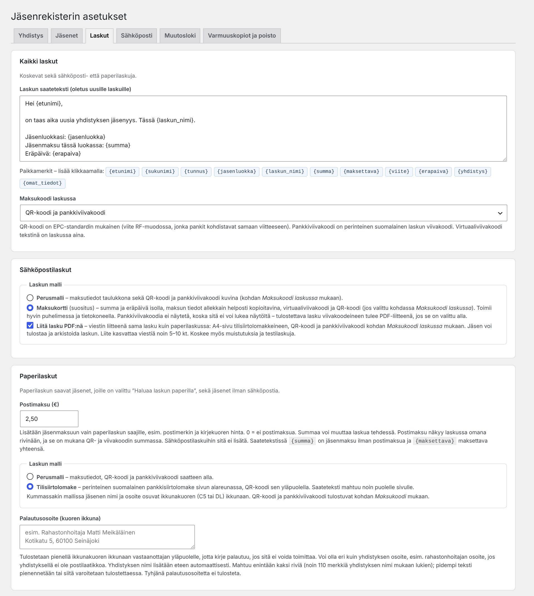 **Asetukset** välilehdillä: laskujen asetukset omissa lokeroissaan. |
| 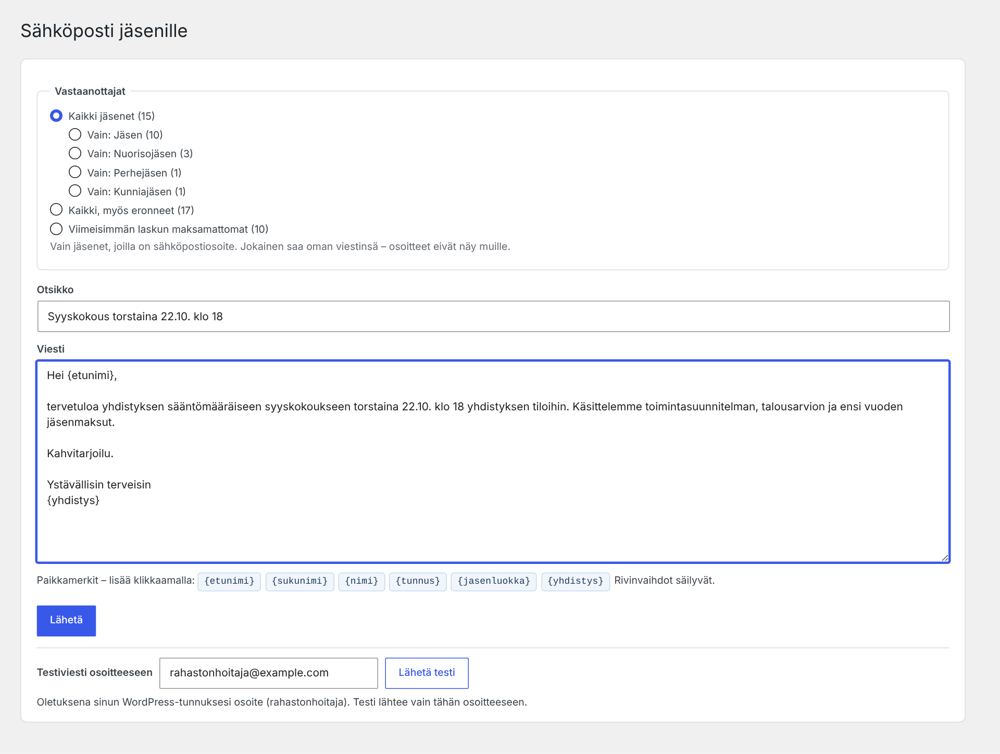 **Tiedote** koko jäsenistölle tai yhdelle luokalle. |  **Laskut:** maksukertymä ja maksujen tuonti. |
|  **Paperilaskut** laskun sivulla: tulosta, laita kuoreen ja merkitse postitetuksi. |  **Tulostettava lasku** ikkunakuoreen (C5 tai DL) tilisiirtolomakkeella. Sähköpostilaskun PDF-liite on samanlainen. |
| 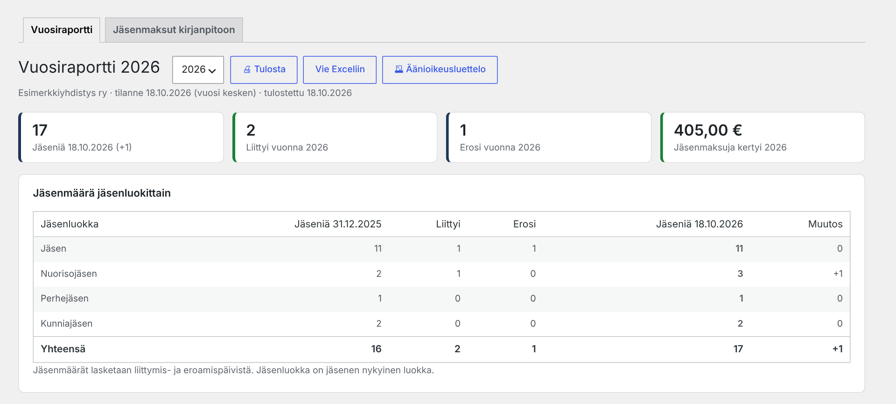 **Vuosiraportti:** jäsenmäärät luokittain ja jäsenmaksut. |  **Muutosloki:** kuka muutti mitä ja milloin. |
| 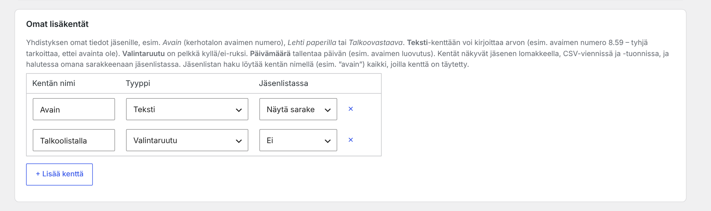 **Omat lisäkentät** ja **merkkipäivien** valinnat asetuksissa. | 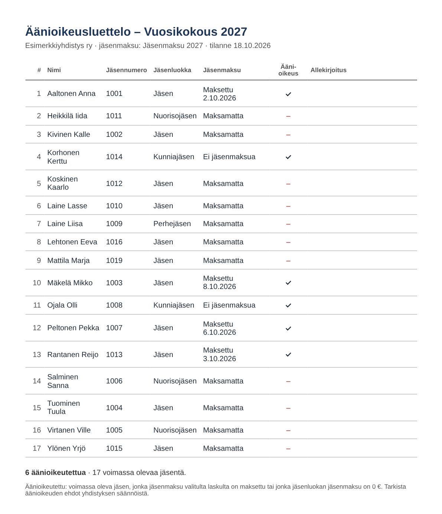 **Äänioikeusluettelo** vuosikokoukseen allekirjoitussarakkeineen. |
| 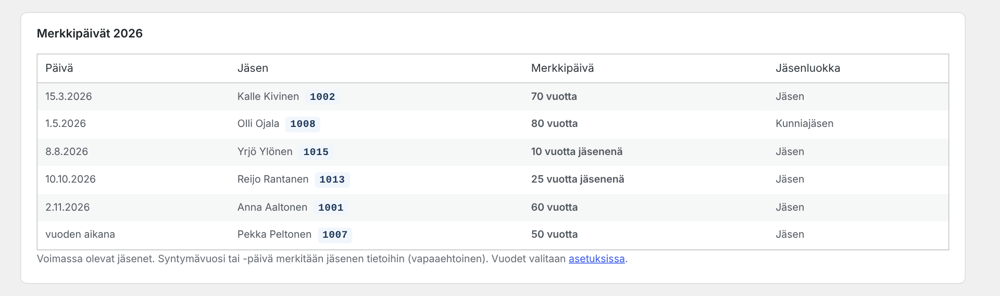 **Merkkipäivät** vuosiraportissa (valinnainen). |  **Kesken kauden liittyvä jäsen** lisätään jo lähetetylle laskulle, ja hän saa oman eräpäivän. |
| 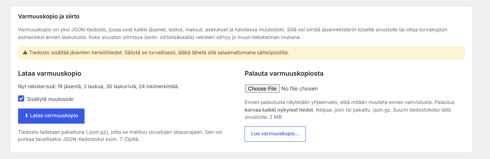 **Varmuuskopio ja siirto** asetuksissa. | 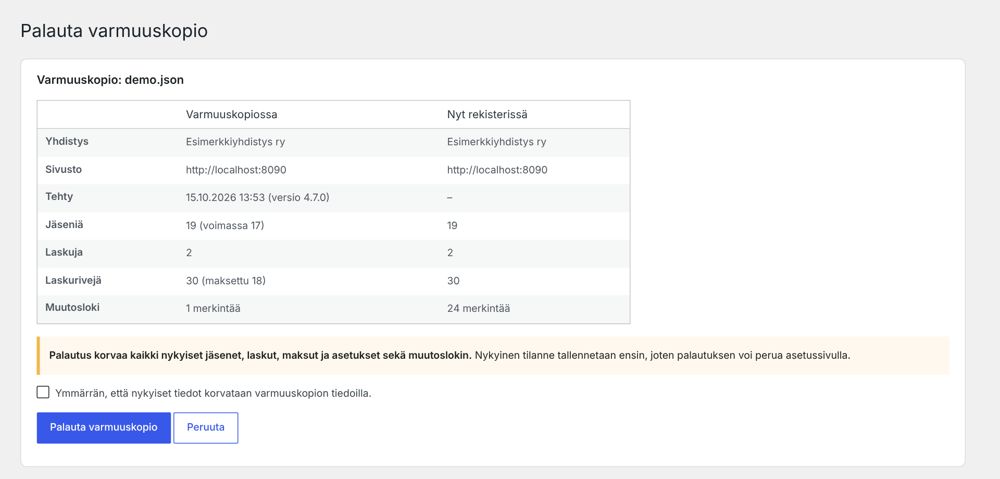 **Palautus:** yhteenveto ja vahvistus ennen kuin mitään muutetaan. |
|  **Jäsenmaksut kirjanpitoon:** vientiehdotus kirjanpitäjälle, erittely jäsenluokittain ja avoimet jäsenmaksut. |  **Sähköpostilasku puhelimessa.** |
| 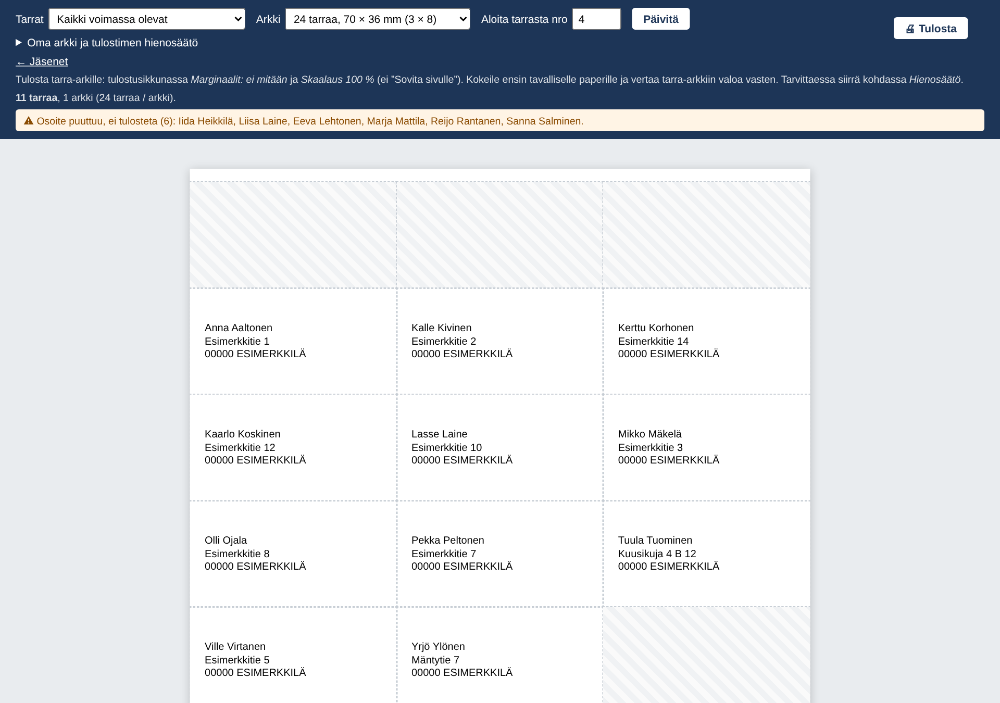 **Osoitetarrat** tavalliselle A4-tarra-arkille: paperilaskun saajat, kaikki, jäsenluokka tai valitut. Vajaan arkin voi käyttää loppuun. | 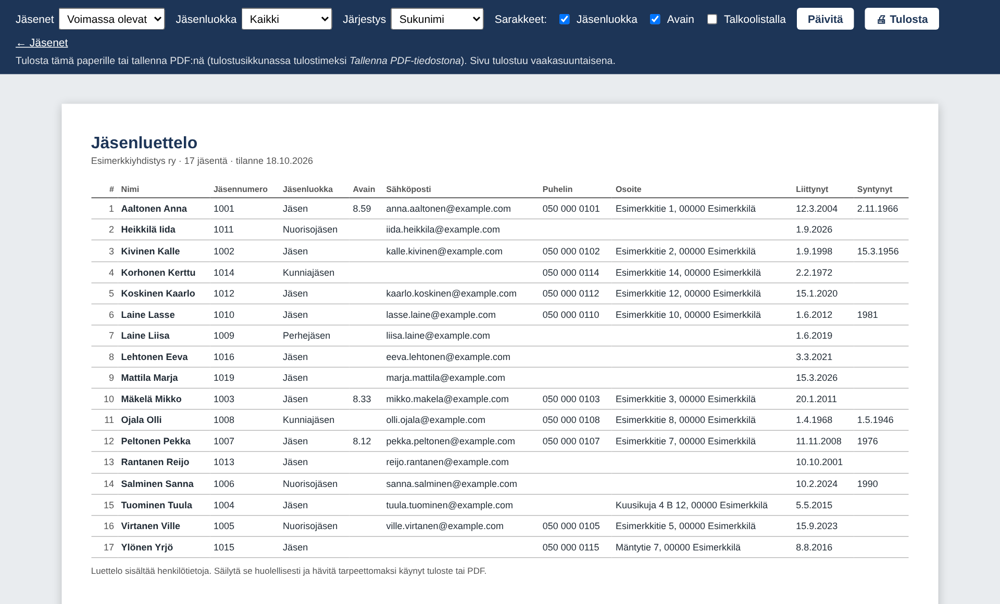 **Jäsenluettelo** paperille tai PDF:ksi: valitut sarakkeet, jäsenluokka ja järjestys. |
| 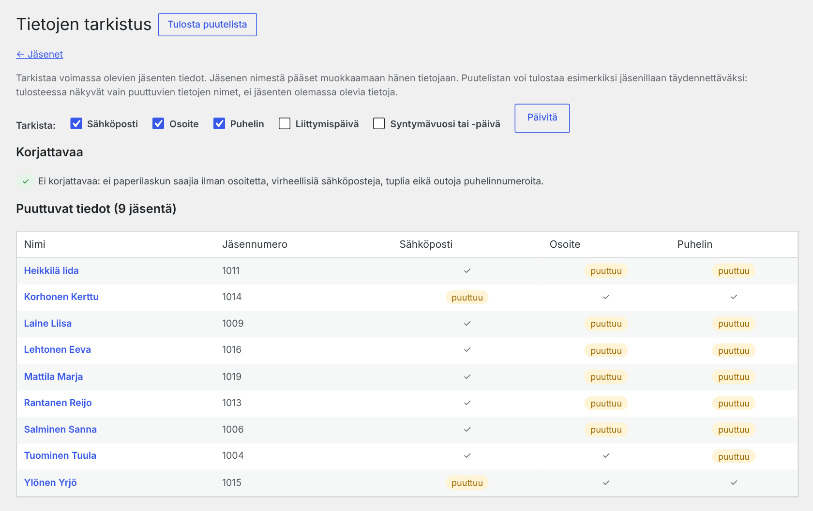 **Tietojen tarkistus:** puuttuvat tiedot ja korjattavat. Puutelistan voi tulostaa jäsenillassa täydennettäväksi. | |
| 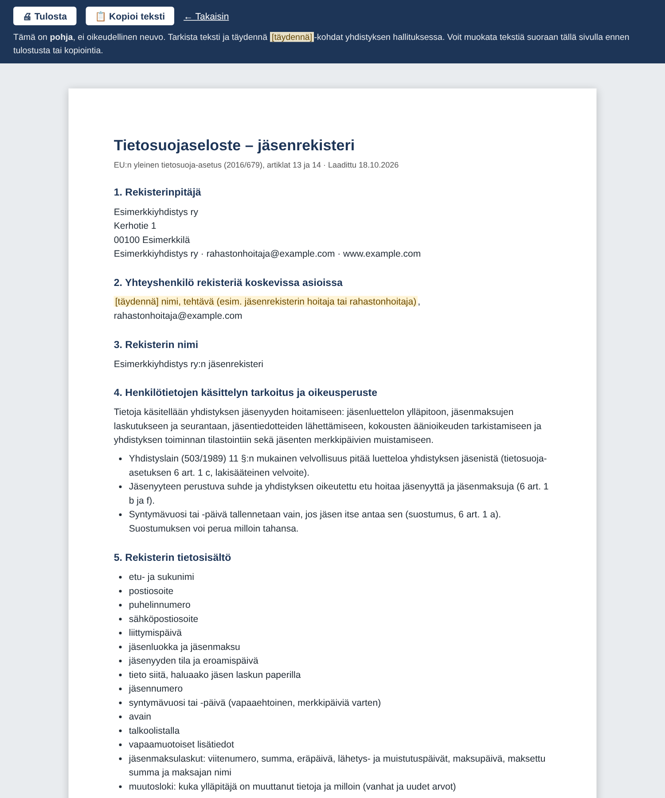 **Tietosuojaselosteen pohja** yhdistyksen tiedoilla. | 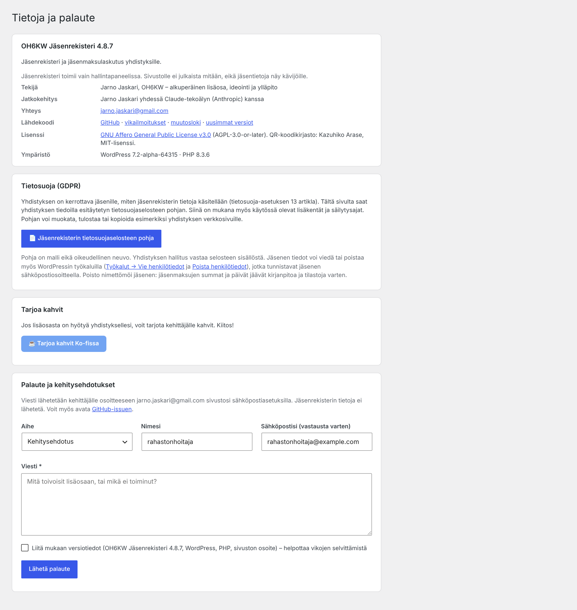 **Tietoja ja palaute:** palautelomake ja Ko-fi. |

## Asennus

1. Lataa uusin `oh6kw-jasenrekisteri.zip` [julkaisuista (Releases)](https://github.com/oh6kw/oh6kw-jasenrekisteri/releases/latest).
2. Valitse WordPressissä **Lisäosat → Lisää uusi → Lataa lisäosa** ja anna zip-tiedosto.
3. Ota lisäosa käyttöön. Valikkoon ilmestyy **Jäsenrekisteri**.

> Käytä julkaisun `oh6kw-jasenrekisteri.zip`-tiedostoa, älä GitHubin vihreän *Code*-painikkeen zip-latausta. Julkaisun zipissä lisäosan kansion nimi on `oh6kw-jasenrekisteri`, jolloin myöhemmät päivitykset korvaavat vanhan version oikein.

**Päivitys:** lataa uusi zip samalla tavalla. WordPress tarjoaa nykyisen version korvaamista, ja tietokanta päivittyy automaattisesti. Ota varmuuskopio ennen päivitystä.

## Käyttöönotto

1. **Asetukset:** yhdistyksen nimi, tilinumero (IBAN, ohjelma tarkistaa sen), lähettäjän sähköposti ja vastausosoite (esim. rahastonhoitaja).
2. **Jäsenluokat:** lisää luokat ja niiden jäsenmaksut. Jos jonkin luokan jäseniltä ei peritä maksua, aseta sen jäsenmaksuksi 0 €.
3. **Jäsenet:** tuo CSV-tiedostosta (Jäsenet → Tuo CSV, malli ladattavissa) tai lisää käsin. Jos jäseniä jää ilman luokkaa, aseta luokka joukkona välilehdellä *Ilman jäsenluokkaa*.
4. **SMTP:** asenna esim. [WP Mail SMTP](https://wordpress.org/plugins/wp-mail-smtp/) tai [FluentSMTP](https://wordpress.org/plugins/fluent-smtp/), jotta viestit lähtevät yhdistyksen oikean sähköpostitilin kautta eivätkä päädy roskapostiin.
5. **Kokeile:** tee lasku ja lähetä testilasku itsellesi. Skannaa QR-koodi pankkisovelluksella, mutta älä hyväksy maksua.

## Jäsenmaksukierros käytännössä

1. **Laskutus → Uusi lasku**, esim. ”Jäsenmaksu 2027”. Tarkista summat ja eräpäivä.
2. Esikatsele ja lähetä testilasku itsellesi, sitten **Lähetä laskut**.
3. Lataa verkkopankista viitesiirtoaineisto tai camt.054 ja tuo se kohdasta **Laskutus → Tuo maksut pankista**. Toista tarvittaessa – samaa maksua ei kirjata kahdesti.
4. Eräpäivän jälkeen maksamattomat saavat muistutuksen automaattisesti tai yhdellä painalluksella.
5. **Paperilaskut:** jos paperilaskuista peritään postimaksu, aseta se kohdassa *Asetukset → Paperilaskut*. Laskun sivun kohdassa *Paperilaskut* ovat jäsenet, jotka haluavat laskun paperilla, ja jäsenet ilman sähköpostia. Valitse **Tulosta postittamattomat**, tulosta A4-paperille (marginaalit: ei mitään tai oletus, skaalaus 100 %), taita reunan merkkien kohdalta ja laita ikkunakuoreen. Merkitse sitten postitetuksi tulostussivun painikkeella. Erääntyneille voi tulostaa paperisen muistutuksen samalla tavalla.
6. **Vuosikokous:** *Jäsenrekisteri → Vuosiraportti* näyttää jäsenmäärät, jäsenmaksukertymän ja merkkipäivät valitulta vuodelta. Tulosta tai vie Exceliin. Painike **Äänioikeusluettelo** avaa tulostettavan luettelon: valitse lasku, jonka maksaneilla on äänioikeus (oletuksena uusin), ja halutessasi vain äänioikeutetut.
7. **Kesken kauden liittyvä jäsen:** kun lisäät uuden jäsenen, lomakkeessa on kohta *Jäsenmaksu jo tehdyltä laskulta*. Valitse lasku, tarkista summa (osan kaudesta voi laskuttaa pienemmällä summalla) ja tallenna. Jäsen saa oman viitteen ja vähintään kolmen viikon eräpäivän, ja lasku lähtee heti sähköpostilla. Saman voi tehdä myöhemmin jäsenen muokkaussivulta. Laskun sivun painike *Lisää laskulle uudet jäsenet* lisää kerralla kaikki laskulta puuttuvat maksavat jäsenet.

## Pankkitiedostot

| Muoto | Mistä saa | Huomioita |
|---|---|---|
| KTL-viitesiirtoaineisto (`.txt`) | Verkkopankin *viitesiirto* tai *saapuvat viitemaksut* | Perinteinen suomalainen muoto, kaikki pankit |
| camt.054 (`.xml`) | Verkkopankin *viiteaineisto XML* / *Saapuvat maksut* | ISO 20022, maksajan nimi skandeineen |
| camt.053 (`.xml`) | Verkkopankin *XML-tiliote* | Vain saapuvat maksut käsitellään |
| Tiliote CSV | Verkkopankin tilitapahtumat CSV-muodossa | Sarakkeet tunnistetaan otsikoista (viite ja summa pakollisia) |

Jos oman pankkisi tiedosto ei aukea, avaa [issue](https://github.com/oh6kw/oh6kw-jasenrekisteri/issues) ja liitä mukaan esimerkki, josta henkilötiedot on poistettu.

## Maksukoodit

- **EPC QR -koodi** (European Payments Council, EPC069-12): moni suomalainen pankkisovellus lukee sen kamerasta, jolloin saaja, tilinumero, summa ja viite täyttyvät valmiiksi. QR-koodissa viite on RF-muodossa (ISO 11649), ja pankit kohdistavat sen samaan viitteeseen.
- **Pankkiviivakoodi**, versio 4 (Finanssiala ry:n opas): Code 128 C -viivakoodi kuvana.
- **Virtuaaliviivakoodi** tekstinä: sen voi kopioida pankkisovellukseen.

Asetuksista voi valita, näytetäänkö QR-koodi, viivakoodi, molemmat vai ei kumpaakaan. Kuvat upotetaan sähköpostiin, joten ne näkyvät ilman ulkoisia latauksia. Kuvien tekemiseen ei tarvita PHP:n GD-laajennusta.

**PDF-lasku:** sähköpostilaskun liitteeksi voi valita PDF:n (*Asetukset → Sähköpostilaskun malli → Liitä lasku PDF:nä*). PDF on sama A4-lasku kuin paperilasku: ikkunakuoren osoite, saate, QR-koodi ja tilisiirtolomake pankkiviivakoodeineen. Jos jäsen on hukannut sähköpostilaskunsa, laskun rivilistan *Tulosta*-painike (erääntyneelle *Tulosta muistutus*) avaa saman A4-laskun tulostusnäkymään. Sen voi tulostaa tai tallentaa PDF:nä selaimen tulostusikkunasta ja lähettää jäsenelle omasta sähköpostista. Tulostaminen ei muuta laskun tilaa.

## Tietosuoja ja tietoturva

Jäsenrekisteri sisältää henkilötietoja. Rekisterinpitäjä on yhdistys, ja sen tulee laatia jäsenrekisteristä tietosuojaseloste.

- Lisäosaa voivat käyttää vain ylläpitäjät (`manage_options`).
- Tallentavat toiminnot on suojattu CSRF-tunnisteilla (nonce). Tietokantakyselyt ovat valmisteltuja, ja kaikki tulostettava tieto escapataan.
- CSV-vienti estää kaavojen suorittamisen taulukkolaskennassa.
- Muutosloki kirjaa jokaisen muutoksen tekijän ja ajan. Koska loki sisältää henkilötietoja (esim. vanhoja osoitteita), vanhat merkinnät poistetaan automaattisesti asetuksissa valitun säilytysajan jälkeen (oletus 2 vuotta). Myös jäsenrekisterin viennit kirjataan lokiin.
- Tiedot pysyvät omalla palvelimellasi. Lisäosa ei lähetä tietoja ulkopuolisille palveluille. Ainoa poikkeus on palautelomake: se lähettää vain itse kirjoittamasi viestin ja halutessasi versiotiedot.
- **Lisäosan poistaminen:** kun lisäosa poistetaan käytöstä, kysytään, säilytetäänkö tiedot vai poistetaanko kaikki taulut ja asetukset, jos lisäosa myöhemmin poistetaan kokonaan. Valinnan voi vaihtaa myös asetuksista. Oletuksena tiedot säilyvät.


## WordPress.org

Lisäosa on valmisteltu WordPressin viralliseen lisäosahakemistoon: englanninkielinen `readme.txt`, yksilöllinen etuliite `jasrek_`, ja [Plugin Check](https://wordpress.org/plugins/plugin-check/) -tarkastus menee läpi ilman virheitä ja varoituksia. Hakemiston kuvat (ikoni, banneri ja kuvakaappaukset) ovat kansiossa `.wordpress-org`.

## Vaatimukset

- WordPress 6.2 tai uudempi
- PHP 7.4 tai uudempi
- MySQL / MariaDB
- Toimiva sähköpostin lähetys (SMTP-lisäosa suositeltava)
- Automaattiset muistutukset käyttävät WP-Cronia, joka käynnistyy sivuston käyntien yhteydessä. Hiljaisella sivustolla voi ottaa käyttöön palvelimen cronin.

## Rakenne

```
oh6kw-jasenrekisteri.php    Lisäosan pääsivu (otsaketiedot ja käynnistys)
uninstall.php               Tietojen poisto lisäosan poiston yhteydessä (jos valittu)
readme.txt                  WordPress.orgin lisäosahakemiston kuvaus (englanniksi)
includes/
  main.php                  Osien lataus, valikot, tyylit ja skriptit
  install.php               Tietokantataulut ja versiopäivitykset
  helpers.php               Asetukset, viitenumero, IBAN, virtuaaliviivakoodi, CSV, sähköposti
  members.php               Jäsenlista, jäsenlomake, joukkotoiminnot
  import-members.php        Jäsenten CSV-tuonti
  invoices.php              Laskut, lähetys ja maksumerkinnät
  import-payments.php       Pankkitiedostojen (KTL, camt, CSV) tuonti ja kohdistus
  paycodes.php              EPC QR -koodi, pankkiviivakoodi, RF-viite
  email-templates.php       Sähköpostin ja laskun HTML-pohja
  mailer.php                Tiedotteet
  cron.php                  Automaattiset muistutukset
  settings.php              Asetussivu
  print.php                 Tulostettavat paperilaskut ja postitusmerkinnät
  report.php                Vuosiraportti (näyttö ja Excel)
  member-print.php          Tulostettava jäsenluettelo
  labels.php                Osoite- ja lähettäjätarrat
  checkup.php               Tietojen tarkistus ja tulostettava puutelista
  voters.php                Äänioikeusluettelo
  backup.php                Varmuuskopio ja palautus (JSON)
  autobackup.php            Automaattinen varmuuskopio sähköpostiin
  confirmations.php         Maksuvahvistukset jäsenille
  privacy.php               Tietosuoja: henkilötietojen vienti ja poisto, tietosuojaselosteen pohja
  log.php                   Muutosloki
  export-xlsx.php           Laskujen Excel-raportti ja kaikki tiedot Exceliin
  xlsx.php                  Excel-kirjoitin (ei ulkoisia kirjastoja)
  about.php                 Tietoja ja palaute -sivu
  pdf.php                   PDF-lasku (liite ja lataus)
  lib/jasrek-qrcode.php     QR-koodikirjasto (MIT)
  lib/jasrek-fpdf.php       PDF-kirjasto FPDF 1.86 (vapaa lisenssi, GPL-yhteensopiva)
assets/                     Hallinnan CSS ja JavaScript sekä tulostettavien sivujen tyylit (print.css, voters.css, print-page.js)
```

## Palaute ja kehitysehdotukset

Kehitysehdotukset ja vikailmoitukset ovat tervetulleita:
- lisäosan oma **Tietoja ja palaute** -sivu (lomake lähettää viestin kehittäjälle)
- sähköposti: [jarno.jaskari@gmail.com](mailto:jarno.jaskari@gmail.com)
- [GitHub-issues](https://github.com/oh6kw/oh6kw-jasenrekisteri/issues)

### Tarjoa kahvit

Jos lisäosasta on hyötyä yhdistyksellesi, voit tarjota kehittäjälle kahvit: **[ko-fi.com/oh6kw](https://ko-fi.com/oh6kw)** ☕ Kiitos!

## Tekijät

- **Jarno Jaskari, OH6KW:** alkuperäinen lisäosa (versio 2.6), ideointi, vaatimukset, testaus ja ylläpito
- **Claude (Anthropic):** tekoälyavustaja, jonka kanssa lisäosaa on kehitetty versiosta 3.0 alkaen

Lisäosan otsaketiedoissa ja WordPress.orgissa tekijänä on Jarno Jaskari (oh6kw).

## Muutokset

Katso [CHANGELOG.md](CHANGELOG.md).

## Lisenssi

[GNU Affero General Public License v3.0](LICENSE) (AGPL-3.0-or-later) © Jarno Jaskari OH6KW

Saat käyttää, muokata ja jakaa lisäosaa vapaasti. Jos jaat muokatun version tai tarjoat sitä palveluna verkon yli, myös muokattu lähdekoodi on annettava saataville saman lisenssin ehdoin.

QR-koodien tekoon käytetään Kazuhiko Arasen [qrcode-generator](https://github.com/kazuhikoarase/qrcode-generator)-kirjastoa (MIT-lisenssi, [includes/lib/LICENSE-qrcode.txt](includes/lib/LICENSE-qrcode.txt)). PDF-laskut tehdään Olivier Platheyn [FPDF](http://www.fpdf.org/)-kirjastolla (versio 1.86, vapaa lisenssi, [includes/lib/LICENSE-fpdf.txt](includes/lib/LICENSE-fpdf.txt)); luokka on nimetty uudelleen (JASREK_FPDF), jotta se ei törmää muiden lisäosien FPDF:ään, ja kuvien lukeminen tiedostoista on poistettu.

---

## In English

*Jäsenrekisteri* is a WordPress membership register and dues-invoicing plugin for Finnish associations. It manages members, membership classes and custom fields, emails individual invoices (or prints window-envelope paper invoices) with Finnish reference numbers, EPC QR codes and Finnish bank barcodes, imports payments from bank files (KTL, camt.054/053, CSV) and matches them by reference, sends reminders and newsletters, produces an annual report for the AGM and keeps an audit log of all changes. The user interface is in Finnish. License: AGPL-3.0-or-later. Feedback: jarno.jaskari@gmail.com · Support: [ko-fi.com/oh6kw](https://ko-fi.com/oh6kw)
